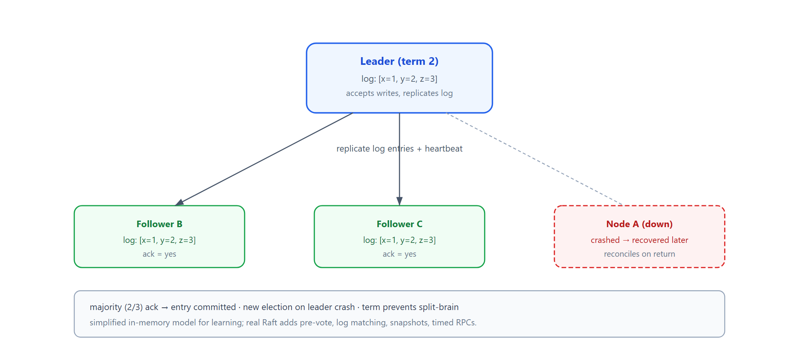
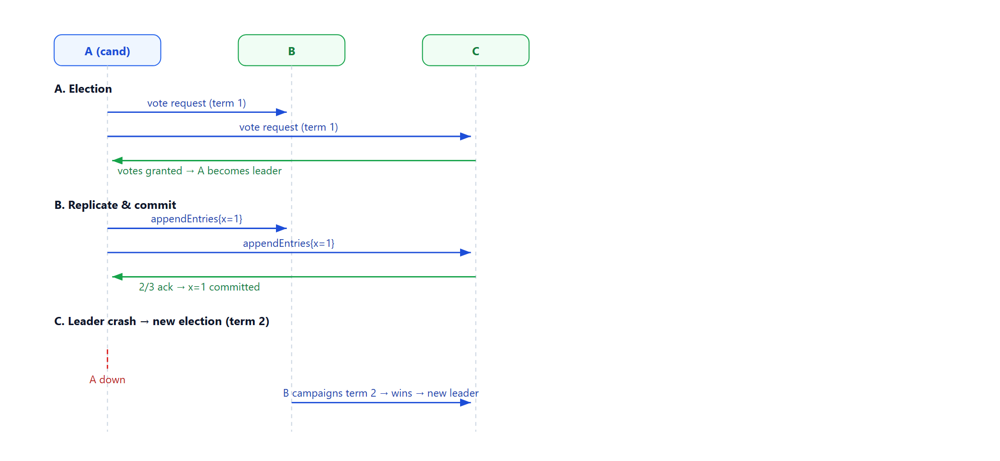

# Learn Raft — Consensus Leader Election & Log Replication

> **Learning / study repo. Simplified teaching demo, NOT production Raft.**
> Shows the core idea: nodes elect one leader, the leader replicates a log to followers,
> and a majority confirms an entry is committed. Tolerates leader crash and re-election.

## The idea

```
        election timeout
  follower ─────────────► candidate ── votes ≥ majority ──► leader
                                                                │
                                                                ▼
                                                    replicate log entries
                                                    to followers; majority
                                                    ack → commit
```

- **Terms** — each election increments a term; there is at most one leader per term.
- **Leader** — handles all writes, pushes log entries to followers via heartbeats.
- **Majority commit** — an entry is committed only when most nodes have it.
- **Crash tolerance** — if the leader dies, followers start a new election with a new term.



## Why this matters

- **Strong consistency without a single point of truth** — any node can be leader; the group agrees.
- **No split brain** — majority vote means two competing leaders cannot both be valid.
- **Log safety** — committed entries survive re-election and are re-reconciled to recovering nodes.

## Run

```bash
python run_all.py
```

Pure Python standard library (synchronously driven, no real network).

## Demo cases

1. **Election** — node A starts election, wins majority, becomes leader.
2. **Replication & commit** — leader proposes `set x=1`, `set y=2`; majority acks, committed.
3. **Leader crash** — A dies; B starts a new election (term 2) and becomes leader.
4. **New leader continues** — B proposes `set z=3`; log stays consistent.
5. **Recovery reconciliation** — A comes back and adopts the leader's authoritative log.

## Flow



## Note

This is a simplified, synchronous, in-memory model for learning. Real Raft adds
pre-vote, log matching, snapshotting, and timed network RPCs.
